# Manual de uso de Aluminior

Guía paso a paso para el operador. Todas las capturas salen de la aplicación publicada
(`https://aluminior-dcvs.onrender.com`), probada el 07/11/2026 con datos de prueba.

Los datos de ejemplo son ficticios: cliente `PRUEBA MANUAL CARPINTERIA GARCIA S.L.`,
unión `ZPRU01` y presupuestos `260015`, `260016` y `260017`.

La barra superior es siempre la misma: Inicio, Artículos, Clientes, Estructuras,
Presupuestos, Producción, Compras e Informes.

Nota sobre la velocidad: el servidor gratuito de Render tarda unos segundos en
responder tras estar inactivo y al guardar. Si un botón muestra "Creando…" o
"Añadiendo…", espera sin pulsar de nuevo.

---

## 1. Crear una ficha de cliente

1. Entra en **Clientes**. Verás el listado (504 clientes antes de la prueba).

   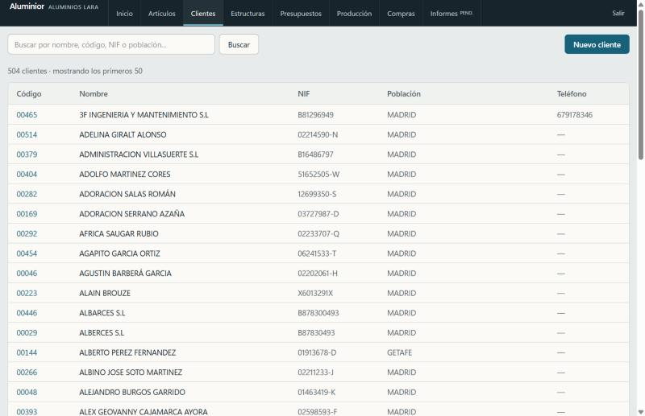

2. Pulsa **Nuevo cliente** (arriba a la derecha).
3. Rellena el formulario. Solo son obligatorios **Código** (se propone el siguiente
   libre, aquí `00526`) y **Nombre o razón social**. El resto es opcional: NIF/CIF,
   nombre comercial, dirección, C.P., población, provincia, persona de contacto,
   teléfono, móvil, correo y tarifa (por defecto 1).

   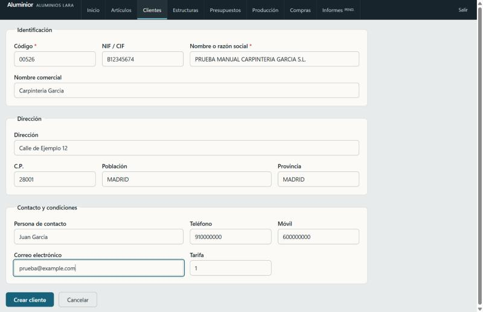

4. Pulsa **Crear cliente**. Vuelves al listado, que ahora indica 505 clientes.

   

Para localizar un cliente, escribe en el buscador parte del nombre, código, NIF o
población y pulsa **Buscar**.

---

## 2. Crear un presupuesto

1. Entra en **Presupuestos**. Verás el listado con número, revisión, fecha, cliente,
   obra, tarifa, estado, líneas y total. Una línea "sin valorar" significa que falta
   algún precio: nunca es un 0 falso.

   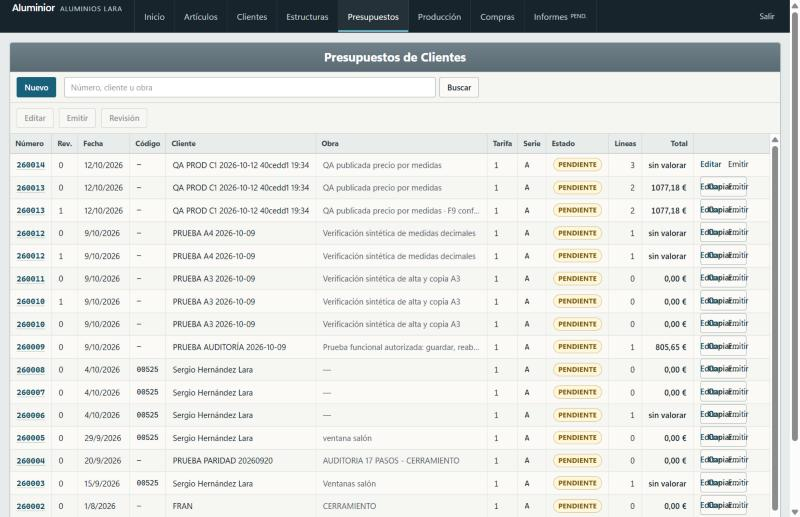

2. Pulsa **Nuevo**.
3. En **Cliente** escribe el código o varios trozos del nombre en cualquier orden
   (por ejemplo `garcia prueba`). Aparece la lista de coincidencias; elige la fila y
   queda guardado el código del cliente.

   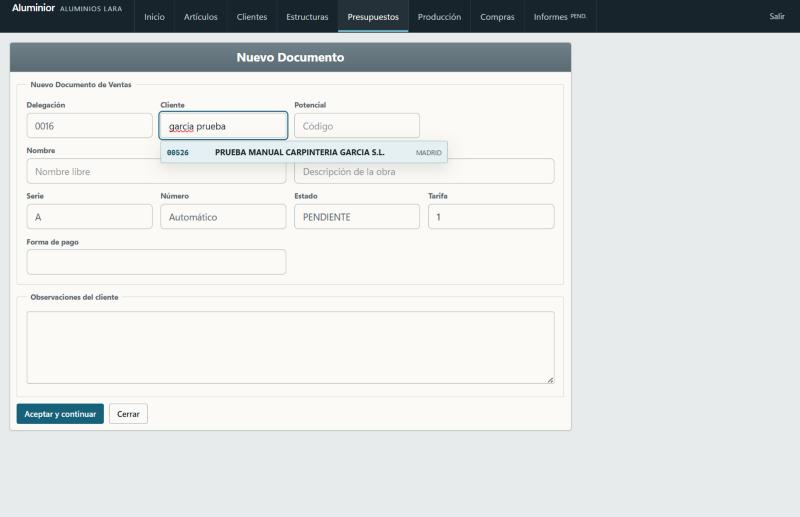

4. Rellena **Nombre** (libre) y **Obra** (descripción). Serie, número, estado y
   tarifa se rellenan solos. El cliente es opcional.

   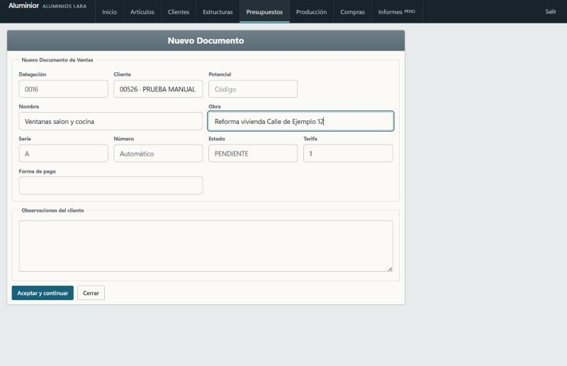

5. Pulsa **Aceptar y continuar**. Se crea el número siguiente (aquí `260015`) y se
   abre el configurador.

   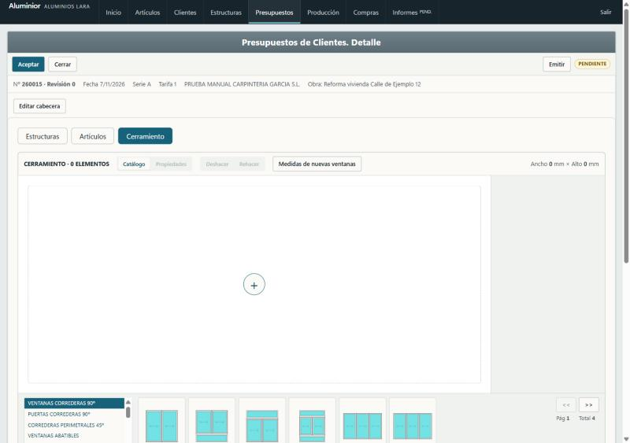

En la cabecera del presupuesto abierto tienes **Editar cabecera**, **Emitir** (PDF),
**Aceptar** y **Cerrar**.

### 2.1 Añadir una ventana (pestaña Cerramiento)

1. En el catálogo inferior elige la familia (por ejemplo *Ventanas correderas 90º*)
   y pulsa el modelo, por ejemplo **C2**. Pulsa el botón **Colocar C2** que aparece
   en el lienzo.

   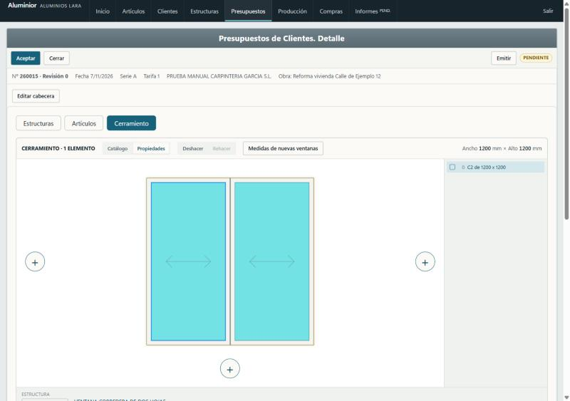

2. Debajo del dibujo cambia **Ancho elemento** y **Alto elemento** (aquí 1500 × 1200)
   y pulsa **Actualizar**.
3. Elige **Serie**, **Vidrio** (botón **Buscar**), acristalamiento, acabado,
   cantidad y las horas de fabricación y colocación.

   **El selector de serie solo ofrece series válidas.** Cada modelo necesita
   unos perfiles que no todas las series tienen, y el vidrio elegido decide si
   hacen falta los de cristal sencillo o los de doble. Por eso, con una ventana
   corredera C2 la lista se reduce de 57 a unas 24 series, y aparece `GMC800D` (la
   serie para doble cristal) y no `GMC800` (solo cristal sencillo). Al cambiar de
   modelo o de vidrio la lista se actualiza unos instantes después. Si ya había una
   serie elegida que deja de servir, se mantiene y se marca "no sirve para estos
   modelos", sin cambiarla por su cuenta. Con varios modelos distintos en el mismo
   grupo, el desplegable general ofrece las series que sirven a todos y, si no hay
   ninguna, las que sirven a alguno; en ese caso elige la serie de cada elemento en
   su ficha (Perfiles). En las capturas siguientes se usó `GMC800` con doble cristal
   (antes de este filtro), por eso la línea sale "sin valorar".

   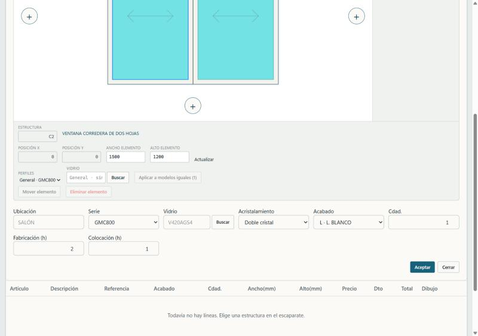

4. Si falta el vidrio, el sistema avisa antes de aceptar.

   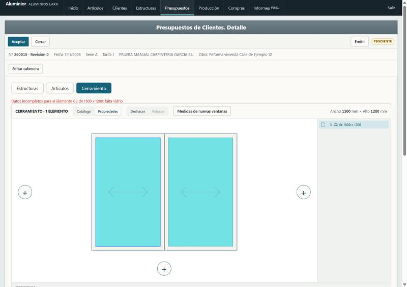

5. Pulsa **Buscar** junto a Vidrio, escribe `V420` y pulsa **Elegir** en la fila
   deseada (`V4204` = doble acristalamiento 4/20/4).

   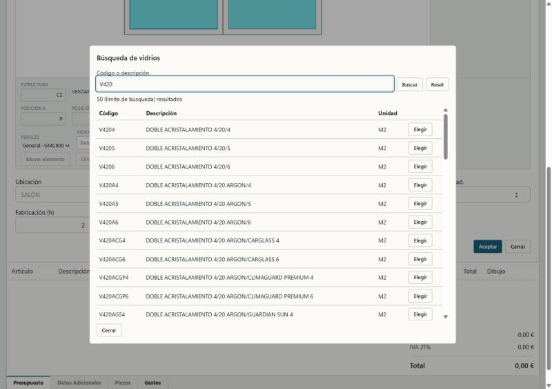

6. Pulsa **Aceptar**. La línea pasa a la tabla inferior con su descripción generada,
   medidas, fabricación y colocación.

   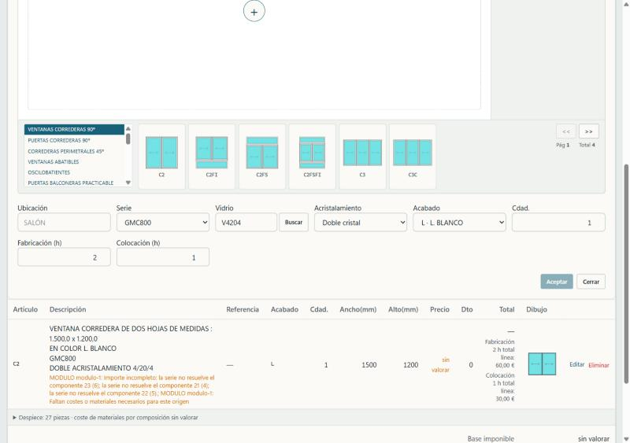

   Con `GMC800` y doble cristal la línea queda **sin valorar**. Cambiando la serie a
   `GMC800D` (botón **Editar** de la línea, luego **Guardar cambios**) la misma
   ventana 1500 × 1200 se valora: 194,77 € de materiales más 90 € de mano de obra
   (2 h de fabricación y 1 h de colocación) = 284,77 €.

### 2.2 Añadir una mosquitera (familia Mosquiteras de Cerramiento)

1. En el catálogo inferior del configurador elige la familia **Mosquiteras**.
   Aparecen los cuatro modelos: enrollable (`PSM001`), corredera (`PSM002`),
   corredera con tirador (`PSM003`) y plisada (`PSM004`).
2. Pulsa el modelo, escribe **Ancho** y **Alto** en milímetros, la cantidad, el
   acabado y la ubicación, y pulsa **Añadir mosquitera** (o Intro).
3. La mosquitera entra en el presupuesto como una línea propia, con su precio por
   medidas, sin afectar a las ventanas que estás diseñando.

   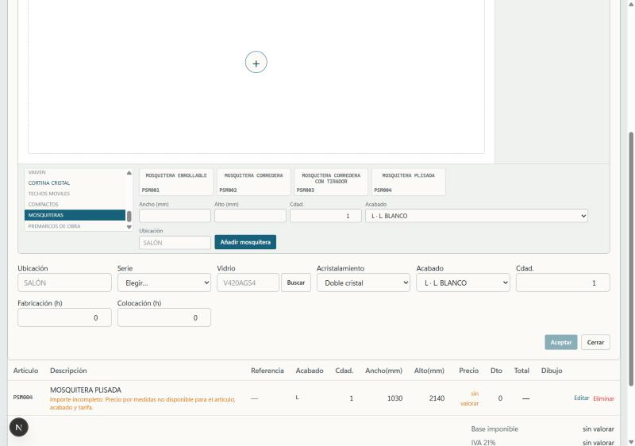

   La captura es de un entorno de pruebas sin tarifa cargada, por eso la línea
   sale "sin valorar"; en la aplicación real `PSM004` de 1030 × 2140 vale 292,60 €.

### 2.3 Añadir un artículo suelto (pestaña Artículos)

1. Abre la pestaña **Artículos**.
2. Escribe el código (`PSM004` = mosquitera plisada), elige el acabado, la ubicación,
   ancho, alto y cantidad. Pulsa **Aceptar**.
3. El precio se calcula por medidas: 1030 × 2140 sale a 292,60 €.

   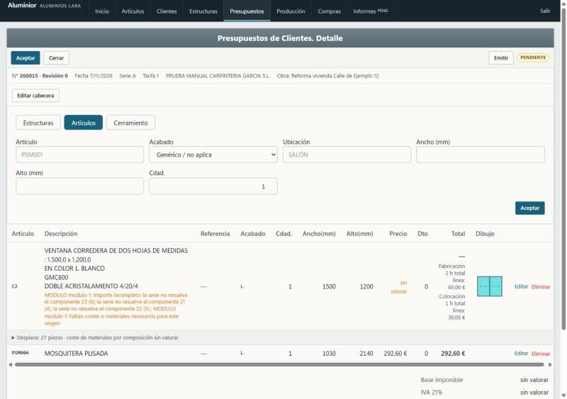

### 2.4 Presupuesto con total válido y PDF

Con solo artículos valorados el presupuesto tiene total. El `260017` (2 mosquiteras
1250 × 2330 a 305,03 €) suma base 610,06 €, IVA 128,11 € y **total 738,17 €**.

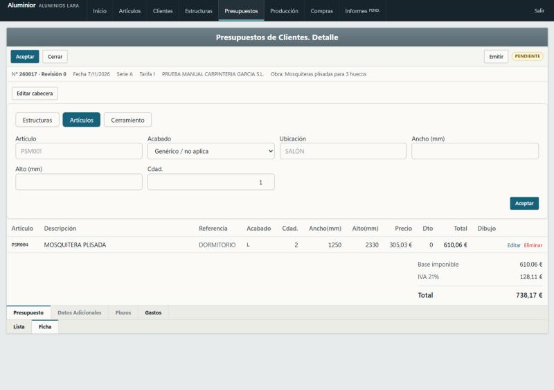

Pulsa **Emitir** para abrir el PDF del presupuesto, listo para imprimir o enviar.

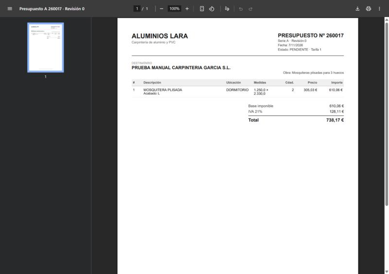

---

## 3. Dar de alta una pieza de unión

Las uniones se gestionan en **Artículos → Uniones**
(`/dashboard/articulos/uniones`).

1. Verás el listado de uniones del catálogo con código, descripción, grosor, L1, L2
   y tipo. Pulsa **Nueva** (arriba a la derecha).

   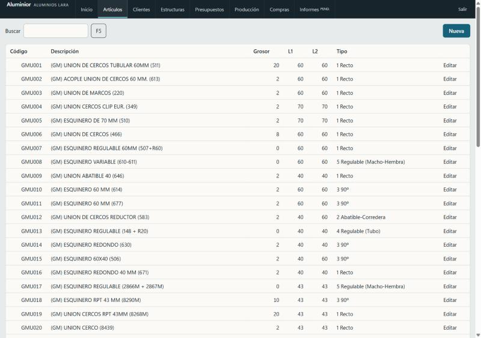

2. Rellena:
   - **Código** (aquí `ZPRU01`) y **Descripción**.
   - **Cantidad** (1) y **Perfil unión 1** (aquí `GM220`). Al escribir el perfil el
     sistema muestra su descripción. El **precio sale del €/m del perfil**.
   - **Grosor**, **L1**, **L2** (aquí 2, 60, 60), **Tipo de U.** (1 Recto) y
     **Mano obra**.
   - **De usuario** queda marcado: protege tu unión cuando se recarga el catálogo.
   - **Series específicas**: si no lo marcas, sirve para todas las series. Si lo
     marcas, elige en la lista las series donde se podrá usar.

   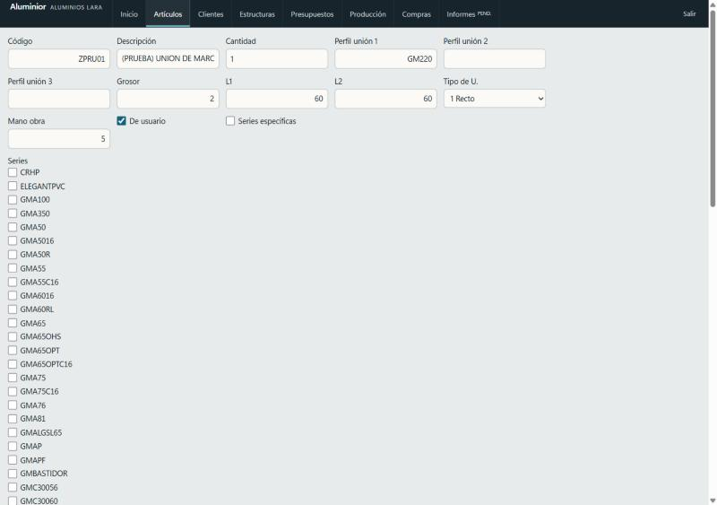

3. Al final del formulario elige la **Imagen**: pulsa un dibujo del catálogo o sube
   un archivo propio con **Subir**. Abajo se ve el precio calculado (aquí 2,78 €/m
   lineal y 1,11 € por 400 mm).

   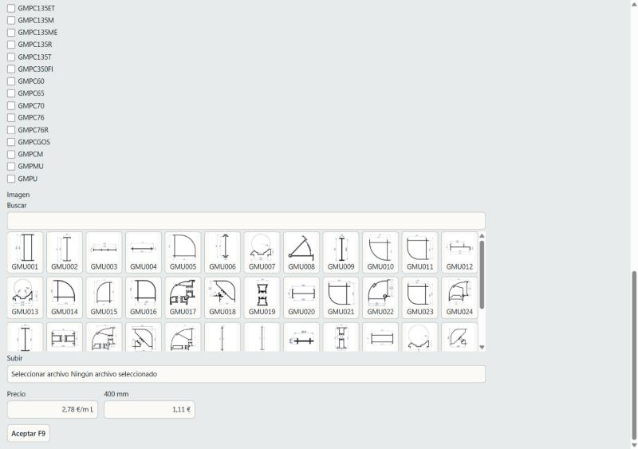

4. Pulsa **Aceptar F9**. La ficha queda guardada y se abre su pantalla de edición.

   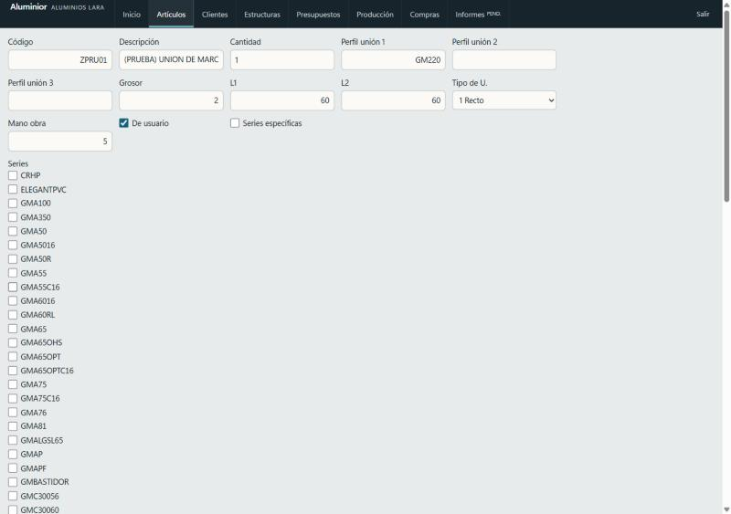

---

## 4. Presupuesto usando la unión nueva

1. Crea un presupuesto nuevo (apartado 2). Aquí `260016`, obra "Terraza".
2. Coloca una ventana **C2** y pulsa el círculo **+** de la derecha: se abre
   **Añadir ventana**. Elige otra **C2**.
3. Aparecen dos ventanas juntas y, en la lista de la derecha, una fila roja
   **UNION NO CONFIG.**: entre dos ventanas siempre hay una unión por configurar.

   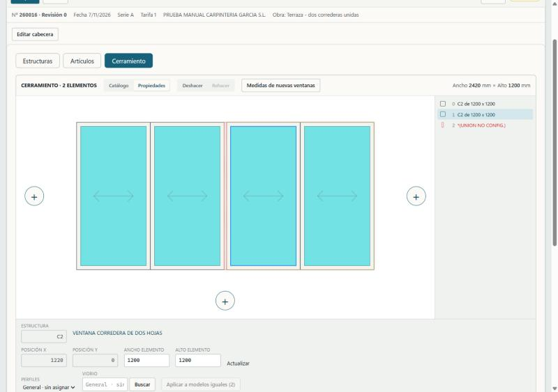

4. Pulsa esa fila. Debajo se abre el panel **UNIÓN 2**. En el selector **Unión**
   elige `ZPRU01 · (PRUEBA) UNION DE MARCOS 60`. Aparecen su dibujo y descripción.
   Pulsa **Actualizar** y desaparece el aviso de cambios pendientes.

   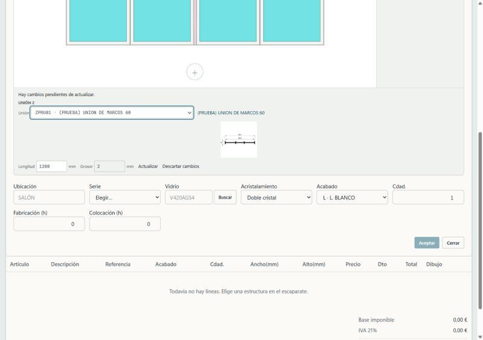

5. Elige **Serie** y **Vidrio** y pulsa **Aceptar**. Se crea una única línea
   **GRUPO** con las dos ventanas (2400 × 1200) y el despiece (56 piezas).

   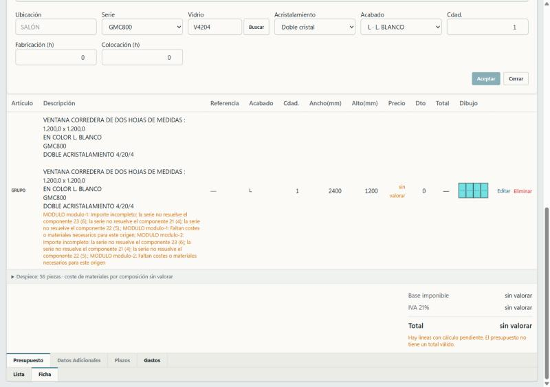

---

## Qué aprendimos en la prueba

- **Funciona en la web publicada:** crear cliente, buscarlo en el presupuesto,
  crear presupuestos, configurar ventanas, dar de alta una unión con imagen, usarla
  en un presupuesto y emitir el PDF.
- **Ventanas sin valorar:** una ventana corredera C2 lleva piezas genéricas
  (ranuras numeradas, por ejemplo 21, 22 y 23: los perfiles de la hoja). Cada serie
  decide qué perfil concreto va en cada ranura. `GMC800` solo lo decide para cristal
  sencillo; para doble cristal lo decide `GMC800D`. Con la combinación equivocada, el
  sistema avisa "la serie no resuelve el componente 21, 22, 23" y deja la línea sin
  valorar en lugar de inventar un precio. Corregido eligiendo la serie adecuada: la
  misma ventana pasa a 194,77 € de materiales.
- **Mosquiteras:** son artículos con precio por medidas, no módulos dibujables. Se
  eligen dentro de Cerramiento (familia Mosquiteras) pero se guardan como línea de
  artículo, no dentro del GRUPO. Siguen abiertas, para confirmar con quien usa
  Productor a diario: qué modelos son los habituales, si necesitan dibujo en el
  lienzo, qué medidas mínimas y máximas admite cada modelo, y si el color, la
  malla o el tirador cambian el precio.
- **Datos de prueba en producción:** estos registros están en la base real
  (cliente `00526`, unión `ZPRU01`, presupuestos `260015`, `260016`, `260017`).
  Conviene borrarlos o dejarlos identificados como prueba antes de usar la app en
  serio.
