# Aluminior: tutorial para empezar a probar

Hola, Javi. Esto es la versión web del programa de presupuestos, hecha a imagen de
Productor. Aquí tienes los pasos básicos, cada uno con su foto y debajo lo que hay
que hacer. La idea es que lo pruebes como harías un presupuesto de verdad y me
digas qué falta, qué sobra o qué no cuadra con Productor.

**Dónde entrar:** https://aluminior.onrender.com con el usuario y la contraseña que
te paso aparte.

**Paciencia al principio:** el servidor es gratuito y, si lleva rato sin usarse,
tarda unos segundos en despertar. Si un botón pone «Creando…» o «Añadiendo…»,
espera sin volver a pulsar.

**Arriba siempre tienes la misma barra:** Inicio, Artículos, Clientes, Estructuras,
Presupuestos, Producción, Compras e Informes.

---

## 1. Clientes

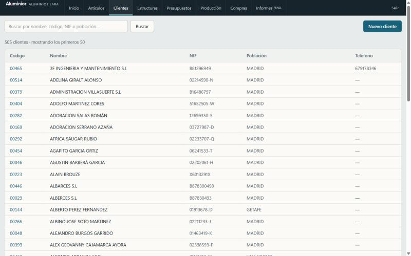

Entra en **Clientes**. Ves todos los clientes importados de Productor. Para buscar
uno, escribe parte del nombre, el código, el NIF o la población y pulsa **Buscar**.

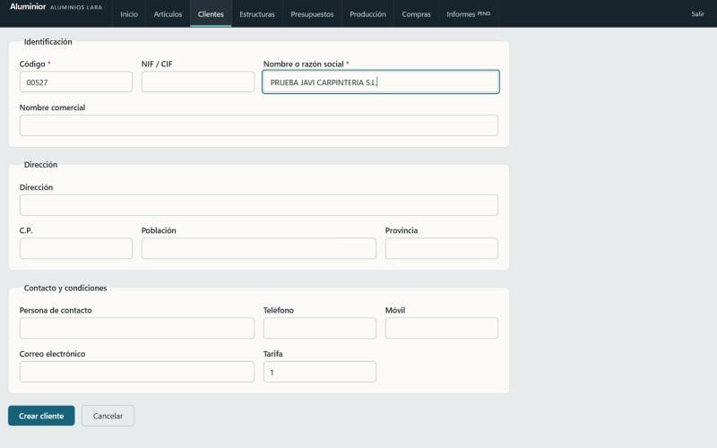

Para crear uno, pulsa **Nuevo cliente**. Solo son obligatorios el **Código** (ya
viene propuesto el siguiente libre) y el **Nombre o razón social**. Lo demás
(NIF, dirección, teléfono, correo, tarifa…) es opcional. Al terminar, pulsa
**Crear cliente**.

Después de crearlo, el cliente aparece en el listado. Para localizarlo rápido,
escribe una parte del nombre (aquí `prueba`) y pulsa **Buscar**; **Limpiar** vuelve
a mostrar todos.

---

## 2. Empezar un presupuesto

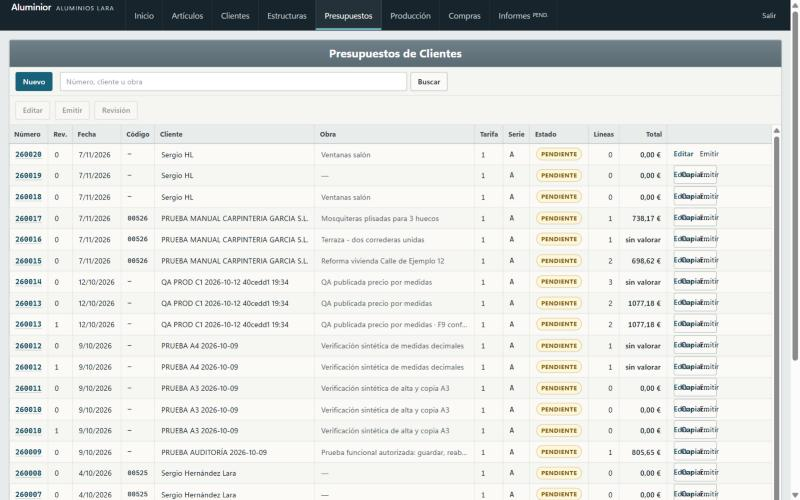

Entra en **Presupuestos**. Cada fila es un presupuesto con su número, fecha,
cliente, obra, estado y total. Si pone **«sin valorar»** es que falta algún precio:
el programa nunca se inventa un 0. Pulsa **Nuevo**.

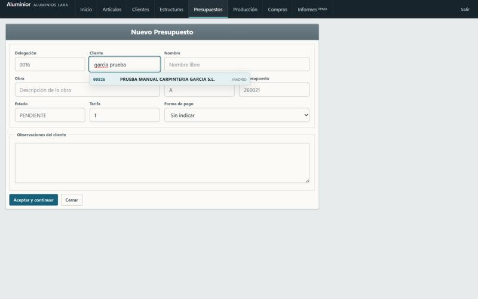

En **Cliente** puedes escribir el código o trozos del nombre en cualquier orden
(por ejemplo `garcia prueba`). Elige la fila que quieras. El cliente es opcional:
si no está dado de alta, déjalo vacío.

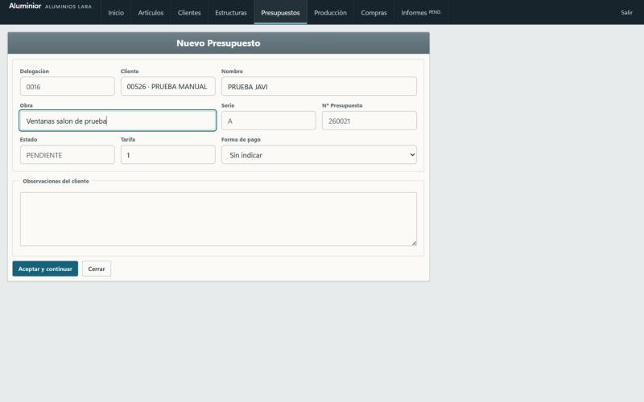

Rellena **Nombre** (el que quieras que salga) y **Obra**. Serie, **Nº Presupuesto**
(ya sale el que le tocará), estado y tarifa se ponen solos. **Forma de pago** es
un desplegable. Pulsa **Aceptar y continuar**.

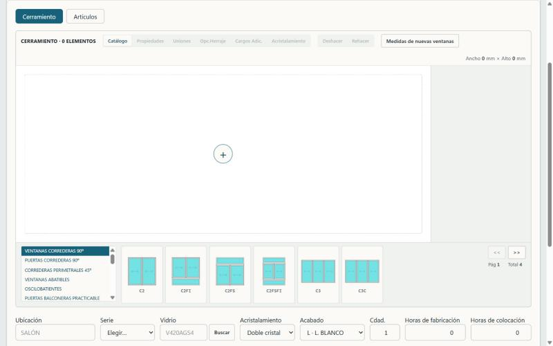

Se abre el **configurador de cerramientos**, que es donde se dibujan las ventanas,
como el diseñador de Productor. Arriba tienes **Editar cabecera**, **Emitir** (el
PDF), **Aceptar** y **Cerrar**. Ya no hay una pestaña Estructuras aparte: en la
línea solo eliges entre **Cerramiento** y **Artículos**.

---

## 3. Dibujar una ventana

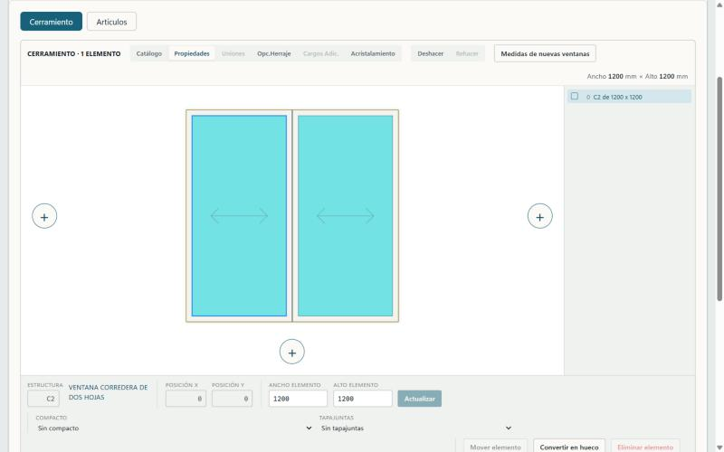

Abajo está el escaparate por familias (correderas, abatibles, oscilobatientes,
fijos…). Pulsa un modelo, por ejemplo **C2**, y luego **Colocar C2**. También puedes
pulsar el **+** del lienzo y elegirla en la ventana que se abre.

Encima del dibujo tienes las pestañas del cerramiento: **Catálogo**,
**Propiedades**, **Uniones**, **Opc.Herraje**, **Cargos Adic.** y
**Acristalamiento**, además de **Deshacer** y **Rehacer**. Las pestañas que aún no
sirven (por ejemplo Uniones con una sola ventana) salen apagadas.

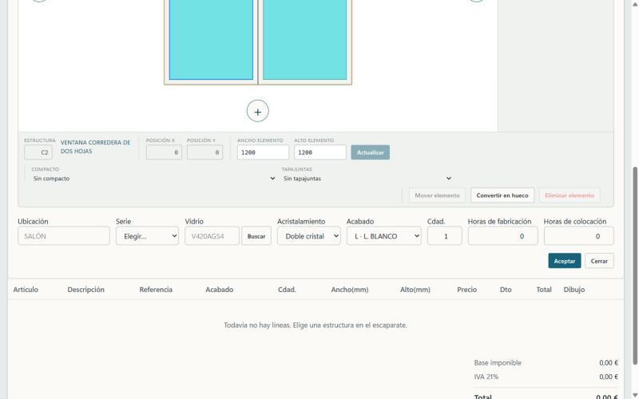

Al pulsar sobre una ventana, debajo del dibujo aparece su ficha en una sola fila:
qué modelo es, su posición en el dibujo (se calcula sola), **Ancho** y **Alto**,
**Compacto** y **Tapajuntas** (para añadir un cajón de persiana o un tapajuntas a
esa ventana) y los botones **Mover elemento**, **Convertir en hueco** y
**Eliminar elemento**.

Más abajo están los datos de toda la línea: **Ubicación**, **Serie**, **Vidrio**,
**Acristalamiento**, **Acabado**, **Cdad.**, **Horas de fabricación** y **Horas de
colocación**.

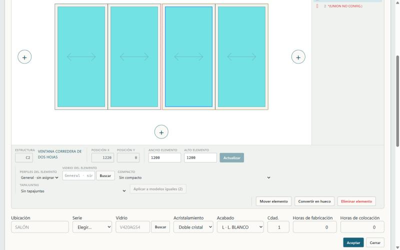

Si hay varias ventanas en el conjunto, cada una tiene además **Perfiles del
elemento** y **Vidrio del elemento**. Sirven para que una ventana lleve una serie o
un cristal distinto del general. Si los dejas en «General», usa lo de la línea. El
botón **Aplicar a modelos iguales** copia el compacto o el tapajuntas elegido a
todas las ventanas del mismo modelo.

**Importante:** cuando cambies el ancho o el alto, pulsa **Actualizar** (el botón
azul) o la tecla **Intro**. Hasta entonces el cambio no se aplica.

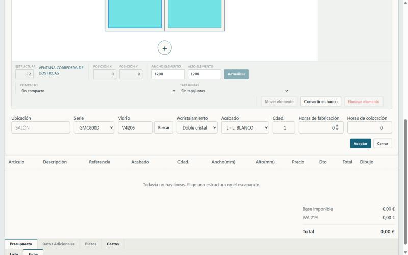

Elige la **Serie** (por ejemplo `GMC800D`, corredera con doble cristal) y el
**Vidrio**.

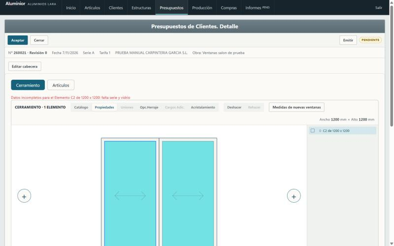

Si te falta algún dato (serie o vidrio), al aceptar sale un aviso en rojo, por
ejemplo «Datos incompletos para el Elemento C2 de 1200 x 1200: falta serie y
vidrio», y no guarda nada.

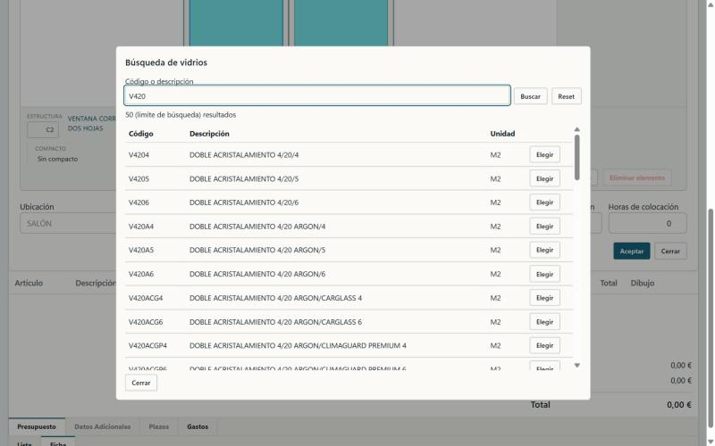

Pulsa **Buscar** junto a Vidrio, escribe parte del código o de la descripción (por
ejemplo `V420`) y pulsa **Elegir** en la fila que quieras.

Pulsa **Aceptar**. La ventana entra en la tabla de abajo con su descripción, medidas
y precio.

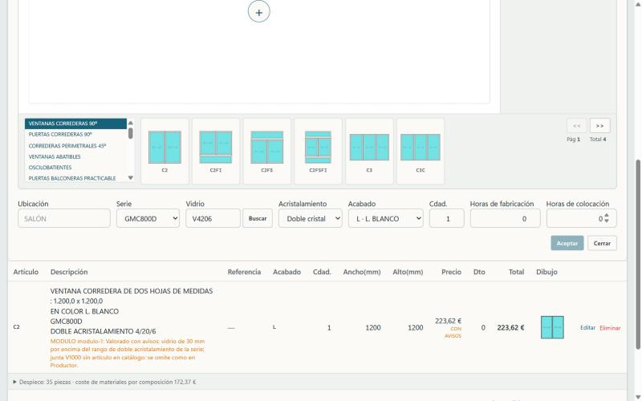

Debajo del precio puede salir **«con avisos»** en naranja: está valorada, pero hay
algo que revisar. En el ejemplo, el vidrio de 30 mm queda por encima del rango de
doble acristalamiento de la serie. Desplegando **Despiece** ves las piezas y el
coste de materiales. Para cambiar algo después, pulsa **Editar** en esa línea.
Mientras editas una línea, el configurador de arriba se esconde para que no haya
dos a la vez.

---

## 4. Varias ventanas juntas y la unión

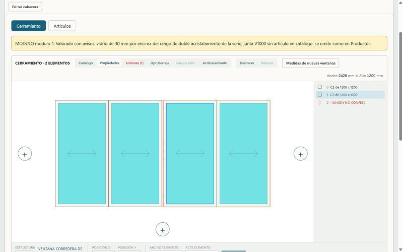

Con una ventana puesta, pulsa el **+** de la derecha o el de abajo para añadir otra
pegada. En la lista de la derecha aparece una fila roja **UNION NO CONFIG.** y la
pestaña **Uniones (1)** se pone en rojo: entre dos ventanas siempre hay una unión
que elegir, como en Productor. El número es cuántas te faltan.

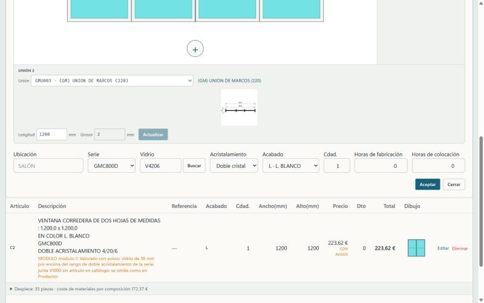

Pulsa esa fila roja (o la pestaña **Uniones**). Abajo eliges la **Unión** en el
desplegable (sale su dibujo) y pulsas **Actualizar**. El grosor sale bloqueado:
viene del catálogo de uniones. Al aceptar, todo el conjunto se guarda como una sola
línea **GRUPO**.

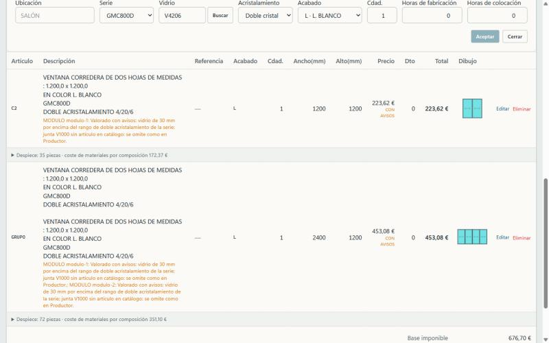

Así queda el GRUPO en la tabla, con el despiece calculado.

---

## 5. Mover una ventana ya colocada

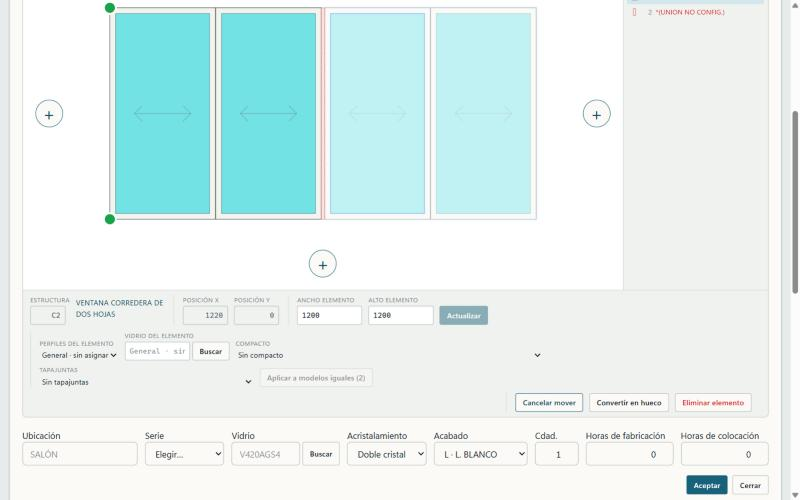

Selecciona la ventana y pulsa **Mover elemento**. Aparecen unos **puntos verdes**:
son los sitios donde puede ir (a la derecha o debajo de otra). Pulsa uno y la ventana
se mueve allí. También puedes **arrastrarla** con el ratón hasta un punto verde.
**Cancelar mover** sale sin cambiar nada.

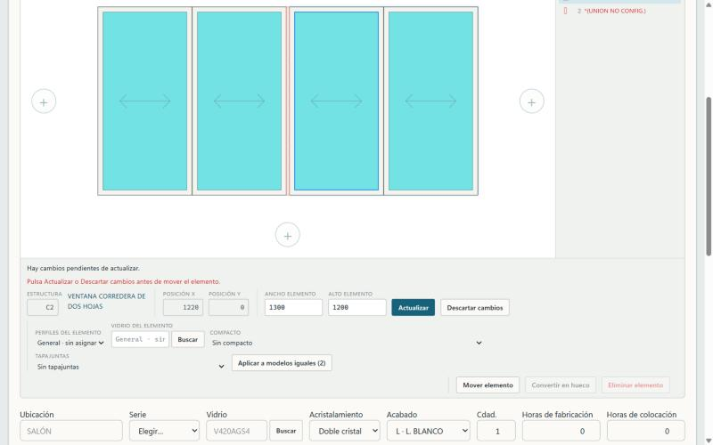

Si has escrito medidas y no has pulsado **Actualizar**, no te deja mover y te avisa
en rojo. Pulsa **Actualizar** (o **Descartar cambios**) y vuelve a intentarlo.

Si te equivocas, tienes **Deshacer** y **Rehacer** en la barra del configurador
(o Ctrl+Z y Ctrl+Y).

---

## 6. Hueco para viga, muro o pared

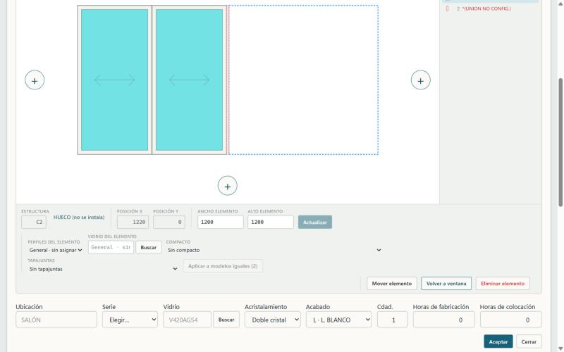

Es lo que en Productor haces con el cartabón y «invisible». Pon un elemento con la
medida del hueco, selecciónalo y pulsa **Convertir en hueco**. Queda en blanco con
un borde discontinuo y la ficha pone «HUECO (no se instala)»: ocupa su sitio y
cuenta en las medidas del conjunto y en las uniones de sus lados, pero **vale 0 €** y
no lleva despiece. Para quitarlo, pulsa **Volver a ventana**.

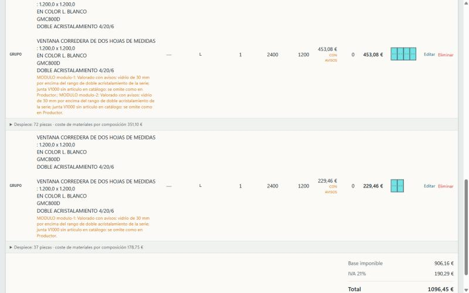

En la tabla, la línea mide el conjunto entero (2400 de ancho en el ejemplo) y el
precio es solo el de la ventana real. En el dibujo de la línea y en el PDF el hueco
no se pinta.

---

## 7. Mosquiteras y artículos sueltos

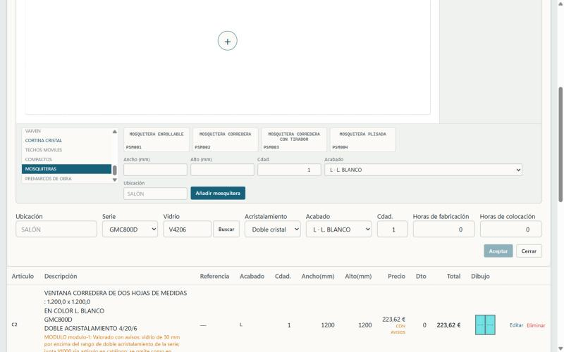

En el escaparate hay una familia **Mosquiteras** (enrollable, corredera, corredera
con tirador y plisada). Pulsa el modelo, escribe ancho, alto, cantidad y acabado y
pulsa **Añadir mosquitera**. Entra como una línea aparte.

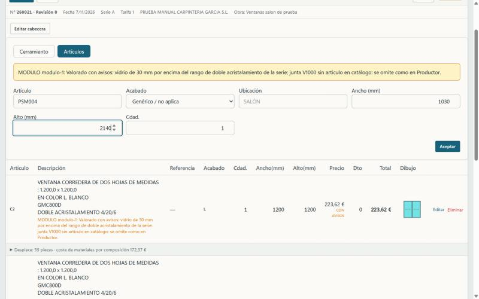

Para cualquier otro artículo usa la pestaña **Artículos**: escribe el código (por
ejemplo `PSM004`), las medidas y la cantidad. **Elige también el acabado** (por
ejemplo `L · L. BLANCO`): con «Genérico / no aplica» la línea queda «sin valorar»
con el aviso «Artículo, acabado o tarifa no disponibles». Pulsa **Aceptar**.

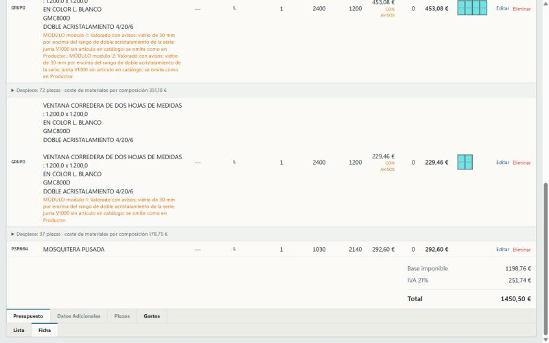

Si el artículo tiene precio por medidas, lo calcula solo. Las líneas ya añadidas
solo permiten cambiar cantidad y ubicación; para otro acabado, elimina la línea y
vuelve a crearla.

---

## 8. Total y PDF

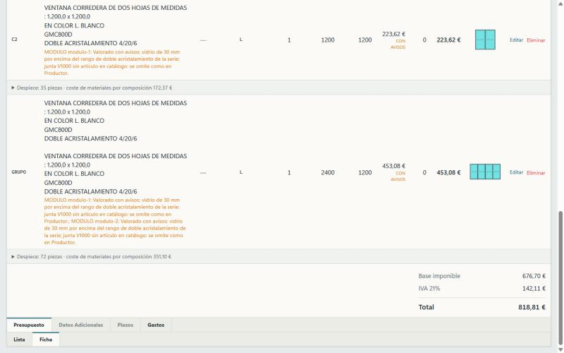

Cuando todas las líneas tienen precio, abajo salen la base, el IVA y el total. Si
alguna línea está «sin valorar», el total no aparece hasta resolverla.

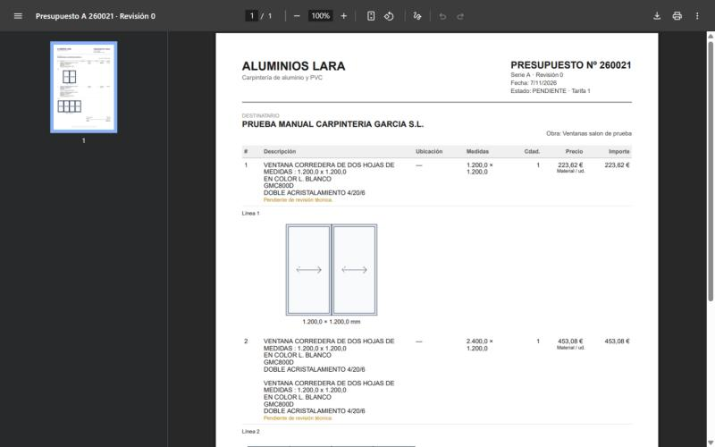

Pulsa **Emitir** para sacar el PDF, listo para imprimir o mandar. Lleva cada línea
con su dibujo y medidas.

---

## 9. Uniones propias (Artículos → Uniones)

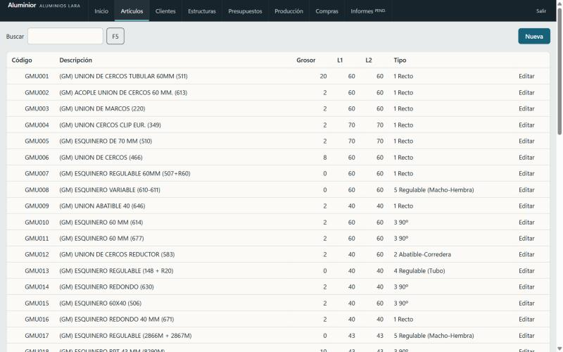

En **Artículos → Uniones** tienes el catálogo de uniones, con su grosor, L1, L2 y
tipo. Pulsa **Nueva** para crear una; **Editar** abre una existente.

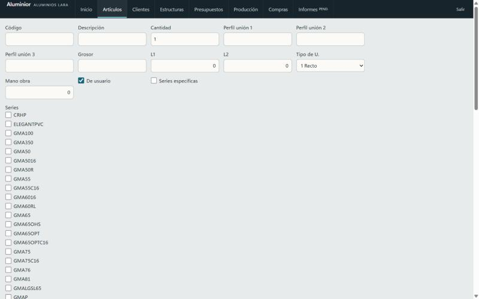

Rellena código, descripción, cantidad, los perfiles que usa (el precio sale de su
€/m), grosor, L1, L2 y tipo de U. Si solo vale para algunas series, marca **Series
específicas** y elígelas.

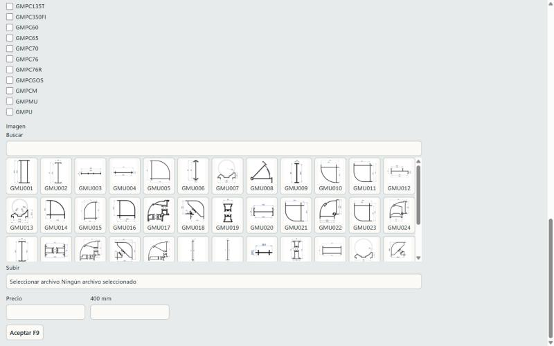

Elige un dibujo del catálogo o sube una imagen propia. Abajo se calcula el precio.
Pulsa **Aceptar F9** y la unión queda guardada en el listado, lista para usarla en
los presupuestos.

---

## Qué significan los avisos en naranja

- **«sin valorar»**: falta algún precio o dato. No es un 0. El texto de debajo dice
  qué falta (por ejemplo, que esa serie no admite ese vidrio).
- **«Valorado con avisos»** (o «con avisos» bajo el precio): el precio está
  calculado, pero hay algo a revisar. Por ejemplo: «vidrio de 30 mm por encima del
  rango de doble acristalamiento de la serie» quiere decir que ese cristal es más
  grueso de lo que admite la serie; cambia a un vidrio más fino o a una serie que
  lo admita.

---

## Qué te pido

1. Haz dos o tres presupuestos reales que ya tengas hechos en Productor.
2. Compara medidas, descripción y precio con los de Productor.
3. Apunta lo que no cuadre, lo que te cueste encontrar o lo que eches de menos, y
   si puedes, mándame una foto de la pantalla.

Usa clientes y presupuestos de prueba con un nombre que se reconozca (por ejemplo
«PRUEBA JAVI») para poder borrarlos luego.
